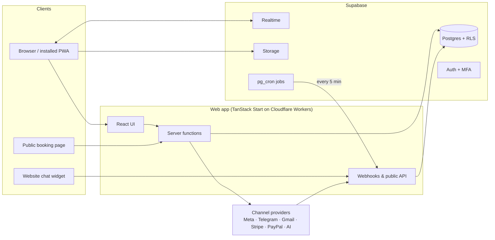

# TeamInbox — Tuk Tuk Connect Hub

**One workspace for every customer conversation, booking and teammate.**

TeamInbox is a multi-business customer-communication and operations platform. It brings
WhatsApp, Instagram, Facebook Messenger, email, Telegram and website chat into a single shared
inbox, and adds bookings, an online booking page, CRM, staff scheduling, automations and an AI
assistant on top. It started as the internal platform of Tuk Tuk 24 Lisbon and is built to serve
any service business (tours, hotels, restaurants, salons, agencies).

[](https://github.com/shaa2020/tuktuk-connect-hub/actions/workflows/ci.yml)


---

## Contents

- [Features](#features)
- [Architecture](#architecture)
- [Tech stack](#tech-stack)
- [Getting started](#getting-started)
- [Scripts](#scripts)
- [Project structure](#project-structure)
- [Testing](#testing)
- [Deployment](#deployment)
- [Security](#security)
- [Documentation](#documentation)
- [License](#license)

## Features

**Unified inbox**

- WhatsApp (Cloud API and connector), Instagram, Messenger, Gmail (connector and IMAP/SMTP),
  Telegram bots and a website live-chat widget, with several accounts per channel.
- Photos, videos, voice notes and files in both directions.
- Assignment, internal notes, labels, priorities, escalation, snooze and bulk actions.
- Keyboard shortcuts and live "viewing / typing" indicators for teammates.
- Delivery states come only from the channel providers. The app never fakes "delivered" or "read".

**Bookings & reservations**

- Bookings with conflict protection for guides and vehicles, tickets with QR check-in, and
  dispatch / tour calendar for tour operators.
- Services with opening hours, capacity, pricing and slot or per-night booking.
- Public, mobile-first online booking page per business.
- PayPal transaction sync with automatic payment matching.

**Customers & growth**

- Contacts and leads, CSV import/export, duplicate detection and merge, custom fields.
- Social planner publishing to Facebook Pages and Instagram.
- Automation workflows with triggers, conditions, delays and actions.
- Analytics dashboards.

**AI**

- Reply drafts, summaries and translation, with knowledge from articles and uploaded documents
  (PDF, Word, text).
- AI Operator that answers customers when the team is away, with optional approval mode.
- Bring-your-own provider (OpenAI, Anthropic, Gemini, OpenRouter or a custom endpoint), metered
  per business.

**Team & administration**

- Roles (admin, manager, agent), invitations and mandatory two-factor authentication with
  recovery codes.
- Staff scheduling: shifts, time off, swaps, clock-in/out.
- Plans and usage limits, Stripe billing, data export, scheduled deletion and ownership transfer.
- Platform console for operators, plus consent-based, read-only support access.

See the full, status-tracked list in [docs/product/feature-inventory.md](docs/product/feature-inventory.md).

## Architecture



- **Tenant isolation lives in the database.** Every business record carries a `workspace_id`,
  and Row Level Security policies, triggers and `SECURITY DEFINER` functions enforce who can read
  or change what. UI checks only mirror those rules.
- **Secrets never reach browsers.** Third-party credentials are encrypted (AES-GCM) per business
  and read only by server code after a role check.
- **Background work** (email polling, website imports, AI Operator, reminders, social
  publishing, automation runs) is triggered by `pg_cron` and fanned out per business.

Details: [docs/architecture/overview.md](docs/architecture/overview.md).

## Tech stack

| Area             | Technology                                                             |
| ---------------- | ---------------------------------------------------------------------- |
| Frontend         | React 19, TanStack Router & Query, Tailwind CSS v4, Radix UI / shadcn  |
| Server           | TanStack Start server functions, Nitro (Cloudflare Workers preset)     |
| Database         | Supabase Postgres, Row Level Security, pg_cron, pg_net                 |
| Auth             | Supabase Auth with mandatory TOTP MFA                                  |
| Realtime & files | Supabase Realtime, Supabase Storage                                    |
| Payments         | Stripe (subscriptions), PayPal Reporting API (finance sync)            |
| Tooling          | TypeScript, Vite, Vitest, ESLint, Prettier, Playwright, GitHub Actions |

## Getting started

**Prerequisites:** Node.js 22+, npm, and a **non-production** Supabase project (or the Supabase
CLI for a local stack). Never point local development at production.

```bash
git clone https://github.com/shaa2020/tuktuk-connect-hub.git
cd tuktuk-connect-hub

# bun.lock resolves through a private registry mirror, so install with npm locally:
npm install --no-package-lock --legacy-peer-deps
npm install --no-save --no-package-lock --legacy-peer-deps @testing-library/dom@10

cp .env.example .env      # fill in the VITE_SUPABASE_* values of your development project
npm run dev               # http://localhost:3000
```

Apply the SQL files in `drizzle/migrations/` to your development database in order (see
[database migrations](docs/architecture/database-migrations.md)). Server-only secrets (service
role key, encryption key, provider keys) are listed in [.env.example](.env.example) and belong in
the hosting provider's secret store, never in `VITE_` variables.

## Scripts

| Command                | Purpose                                                                        |
| ---------------------- | ------------------------------------------------------------------------------ |
| `npm run dev`          | Start the development server                                                   |
| `npm run build`        | Production build                                                               |
| `npm run preview`      | Serve the production build locally                                             |
| `npm run lint`         | ESLint (Prettier enforced)                                                     |
| `npm run format`       | Format the codebase with Prettier                                              |
| `npm test`             | Unit tests (Vitest)                                                            |
| `npm run test:db`      | Database policy tests on a throwaway PostgreSQL 16 (needs PostgreSQL binaries) |
| `npm run test:upgrade` | Simulates upgrading a production-shaped database with the latest migrations    |

## Project structure

```
├── src/
│   ├── routes/                 File-based routes (TanStack Router)
│   │   ├── _authenticated/     Signed-in app pages (inbox, bookings, settings, …)
│   │   ├── api/public/         Webhooks, widget API, OAuth callbacks, cron entry point
│   │   └── book.$slug.tsx      Public booking page (plus auth, invite, ticket pages)
│   ├── components/             Shared UI (app shell, kit, dialogs, shadcn primitives in ui/)
│   ├── hooks/                  React hooks (workspace context, mobile detection)
│   ├── lib/                    Domain logic
│   │   ├── *.functions.ts      Server functions callable from the browser (auth + RLS)
│   │   ├── *.server.ts         Server-only modules (never bundled for browsers)
│   │   └── *.ts / *.test.ts    Pure, unit-tested logic
│   └── integrations/supabase/  Supabase clients and generated database types
├── drizzle/
│   ├── migrations/             Ordered, idempotent SQL migrations (+ journal)
│   └── manual/                 Combined fallback SQL for manual application
├── db-tests/                   Database policy tests (RLS, RPCs, triggers)
├── scripts/db-test/            Throwaway-Postgres harness used by test:db / test:upgrade
├── public/                     PWA assets, service worker, website chat widget
├── docs/                       Product, architecture, operations and user guides
└── .github/                    CI workflow, issue and pull request templates
```

## Testing

- **Unit tests:** pure domain logic (booking rules, payment matching, keymaps, parsers, etc.)
  in `src/lib/*.test.ts`.
- **Database policy tests:** `db-tests/` applies every migration to a fresh PostgreSQL (and
  re-applies them to prove they are idempotent), then checks row-level security, RPC
  permissions and triggers. Any change to policies or RPCs needs a test here.
- **Continuous integration:** every push and pull request runs lint, type-check, unit tests,
  database tests and a production build ([ci.yml](.github/workflows/ci.yml)).

Strategy and coverage: [docs/development/testing.md](docs/development/testing.md).

## Deployment

The app builds to a Cloudflare Workers bundle, and data lives in Supabase. Production
releases apply new migrations first (staging, then production after a backup), then publish
the app. See [docs/operations/deployment.md](docs/operations/deployment.md),
[docs/operations/go-live.md](docs/operations/go-live.md) and the
[launch checklist](docs/operations/launch-checklist.md).

## Security

- Mandatory two-factor authentication. Lost phones are reset by an admin (audited) or with
  one-time recovery codes.
- Invite-only accounts by default. Public sign-up is a feature flag.
- Rate limiting on every public endpoint, signed webhooks (Meta, Stripe, Telegram) and SSRF
  protection for tenant-supplied URLs.

Please report vulnerabilities privately as described in [SECURITY.md](SECURITY.md). The full
review is in [docs/architecture/security-audit.md](docs/architecture/security-audit.md).

## Documentation

All documentation is indexed in [docs/README.md](docs/README.md). Engineering rules that every
change must follow are in [AGENTS.md](AGENTS.md); contribution workflow is in
[CONTRIBUTING.md](CONTRIBUTING.md); release history is in [CHANGELOG.md](CHANGELOG.md).

## License

Proprietary. Copyright © 2026 Tuk Tuk 24 Lisbon. All rights reserved. No part of this
repository may be copied, modified or distributed without written permission.
